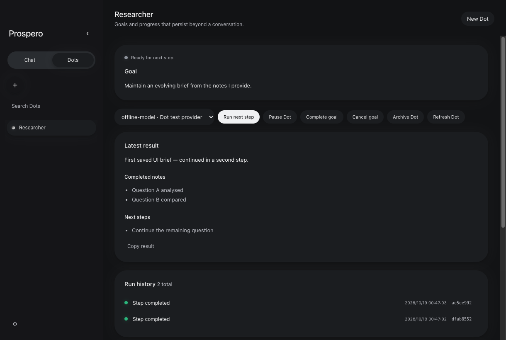
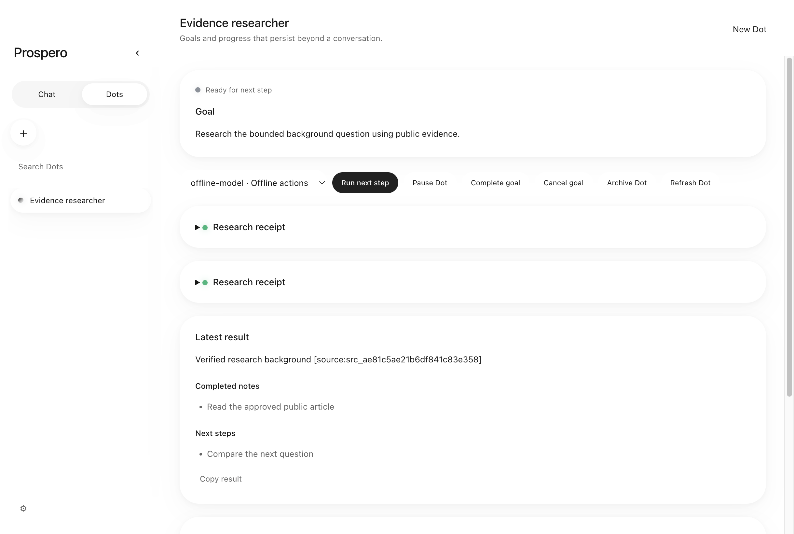
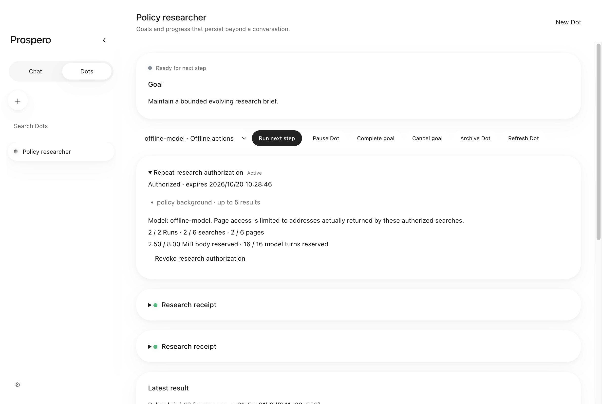
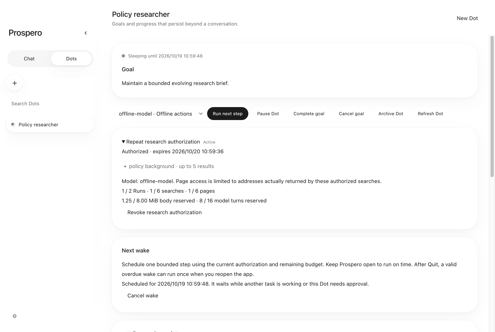
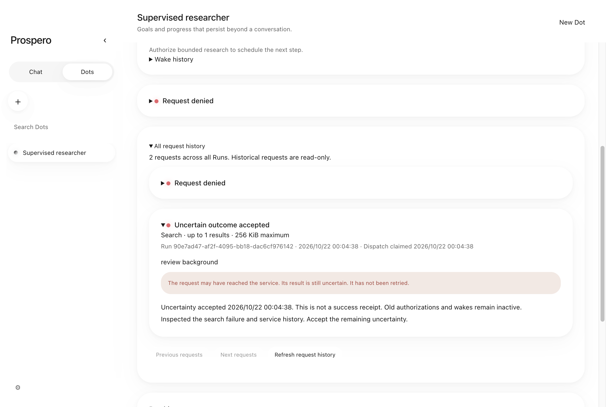
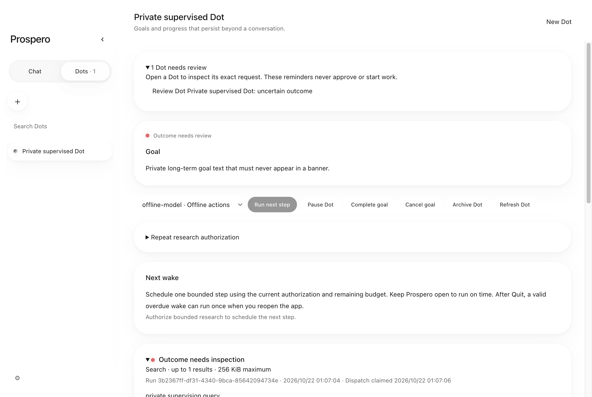
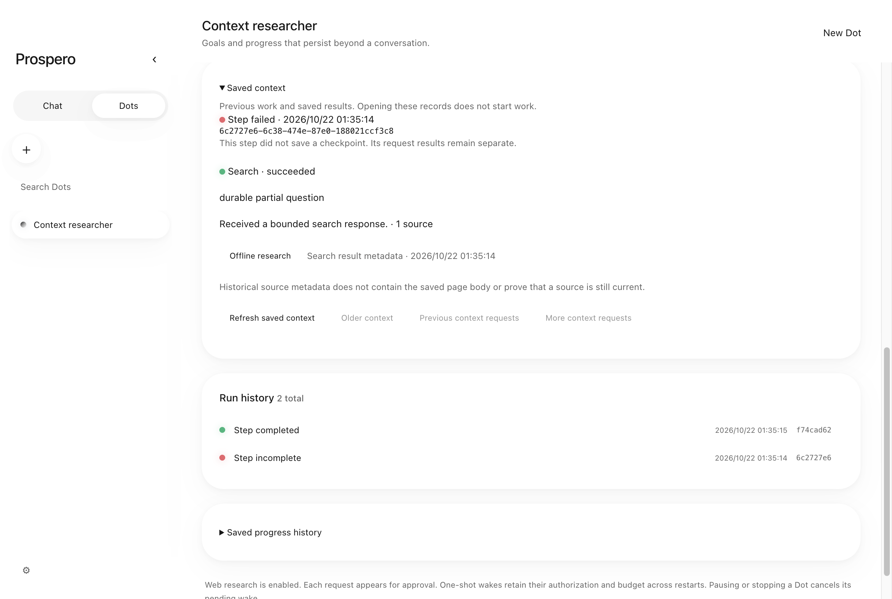

# Dots 完整功能与界面交付记录

当前请求：继续完成完整 Dots，并加入深色模式、移除界面和对话中的 Prospero 品牌图标、品牌字号增加 50%、侧栏 50% 透明模糊、左右分列的无边框大圆角消息与黑白光晕、实际耗时标签、可折叠团队记录，以及蓝/绿/红状态灯。

这份记录跟踪整个目标，不将局部实现当作完整交付。2026-10-08 的 M003 是历史基线；2026-10-18 的完整功能请求扩大了实施范围。当前保留原有未提交的 agent team 工作，不提交或 push。完整目标尚未完成。

## 当前可运行的切片（2026-10-22）

正常 Prospero 界面可切换 Chat / Dots，创建 Dot、选择模型、执行一次有限步骤、查看真实 streaming 和保存结果，继续下一步、暂停/恢复、完成/取消/归档，并分页查看 Run 与 checkpoint 历史。创建不会产生 Chat conversation。退出重开保留相同 identity 和结果，下一 Run 实际消费上次 checkpoint；明确设置的一次性 wake 可在原授权与累计预算内自动开始下一 Run。

当前 Dot 工具包含内部 `record_progress`，以及在 Web Search 配置有效时的 standalone `web_search` / `fetch_page`。每个外部请求单独展示准确预览并走持久审批，没有文件或 shell 能力。未配置 Web 时界面明确说明只能起草笔记。模型提出的 summary/completed/next 是继续数据；Run 成功不自动完成长期 goal；用户可明确设置一次未来唤醒。

为满足 M007 vertical slice 并观察真实应用边界，提前实现 M013 的手动创建、执行和监督部分；审批、policy、wake 控件随实际能力加入。这一调整不改变完整 Research MVP 的验收标准。

## 已接入的运行与持久化

- `packages/persistence` 仍通过 `persistence → dots` 复用纯 domain。普通读取不做恢复。
- 显式 `recoverInFlight(at, hasExclusiveOwnership, limit)` 在一个事务中校验、结束遗留 pending/running pair；失去所有权或任一写入失败整批 rollback。Electron 主进程在 profile 单实例锁内、任何 service dispatch 前分批恢复；窗口重开不重复运行 startup recovery。
- `ExecutionAdmission` 为 Chat 和 Dot 提供同一 main-owned execution slot，初始化前占位，cleanup 后释放；团队成员属于 lead reservation。忙碌时拒绝派发，不提前创建 Dot Run 或解密凭据。
- schema v4 新增 append-only `dot_checkpoints`，v5 增加持久 intent/audit，v6 增加 research policy/usage/proof，v7 增加 wake/audit，v8 增加 immutable human review，当前 v9 增加 alert batch claim。`finishRunWithCheckpoint` 将 Dot、terminal Run 和 checkpoint 原子提交；CAS、校验或写入失败不产生半份进展，也不自动 retry。不确定的 in-flight 状态保留供检查。
- checkpoint 有 summary、completed/next notes、owner/run ID、revision/time；严格 rehydration、深度冻结和 64 KiB UTF-8 上限。它不是执行权限或已验证外部效果。
- `DotExecutionService` 使用现有 `core.runAgent`，模型调用前保存 pending/start，限制 8 model turns、12 tool calls、120 秒 active、180 秒总时间、96 KiB context。失败/取消/未提交进展不制造 checkpoint。
- Provider session 仅 main 解密 endpoint-bound credential，整个 Dot session 保持 provider reservation，实际 native 操作晚到不提前释放或派发。凭据、ModelPort 和通用执行 RPC 不跨 preload。
- `DotApplication`、19 个窄 IPC 方法和冻结的 preload API 使用已有 sender/frame/URL/arity/payload validation；Dot/Run/checkpoint/当前 Run intent/policy snapshot 在同一 SQLite read transaction 读取，publication sequence 防止晚到读取覆盖新状态。DTO 显式投影，不传出 core continuation。
- Chat/window 与 Dot/app 生命周期分开。关闭窗口或 renderer crash 取消 Chat 和交互配置操作，Dot 的模型初始化与运行继续；Quit 取消并等待两者 cleanup 后关闭数据库，没有独立 daemon。
- 凭据选择器以 persistence 的 `SCHEMA_VERSION` 限定已知版本，保留 metadata/endpoint/model/密文/identity 检查。复制仅选中的 provider/密文，不包含 Dot/Run/checkpoint。

## Core 挂起原语

[ADR-008](decisions/ADR-008-runtime-suspension.md) 定义 opt-in 的 `SuspendableAgentOptions`。只有支持明确 `onSuspended()` cleanup 的 host 可返回 suspended；Chat 默认等待/超时/取消行为保持原样。

公开 history 保持配对，成功前缀保留，当前请求有明确尚未执行的占位结果，后缀明确 skipped。严格冻结的继续点最多 1 MiB；继续时重新 prepare 和决策，只替换已验证的那一个占位结果。原有拒绝、累计 model/tool/active time、绝对 wall 与当前 approval deadline 保留，session grants 不恢复。

## 持久 intent 与 runner 继续边界

[ADR-009](decisions/ADR-009-durable-dot-intent.md) 的仓储和 runner 已接入正式 Electron composition 与正常界面。用户可批准并继续、拒绝、重开后查看同一个待批准请求；未知结果保留并阻断；用户可通过明确的不可变人工确认记录允许另行发起新工作，旧请求仍是 unknown。

- v5 新增 `dot_intents` / `dot_intent_events`，绑定 Dot/Run/revision、provider endpoint/model、policy revision、确切 call/preview/digest、expiry 与 core continuation。binding 不可变，event append-only，状态变更与 audit 同一事务 CAS。
- Approve 仅记决定；`dispatchIntent` 是独立、一次性的持久 claim。`settleIntent` 保存有界 receipt；无法确认的结果变为 unknown，并原子 interrupt Run。unknown 阻止该 Dot 新 Run，不把失败当作未发生。
- startup 校验并保留有效 pending/approved，不自动调用模型或工具；到期/时间异常失效；dispatch gap 变 unknown，成功 receipt 不覆盖。带挂起 Run 的恢复分页不会饿死其余 Run。
- `resumeApproved` 重新获得共享 admission，继续同一个 Run，重新 prepare/检查 preview、provider、policy，再经过 core permission。执行前再次核对，覆盖 decision 与 dispatch 之间的撤销。新请求需要新 intent，不能套用前一个批准。
- invocation 保存准备时的 configuration binding；准备/挂起期间的配置变化不能被重新标成新版批准。初始化失败/退出不消费批准；晚到的 session 释放且不派发。显式 Stop/暂停原子取消未派发 intent 与 Run。
- 专项使用真实 core/SQLite/reopen、测试研究端口和一个子进程文件 marker 验证 dispatch 后未 ack 的 crash gap。新增正式 Web port/IPC/UI 的研究闭环，网络/DNS/native seams 保持离线；不证明真实搜索服务、TLS 或真实模型研究质量。

## 正式 Dot-owned Web 研究

[ADR-010](decisions/ADR-010-dot-web-research.md)：复用实际 Brave/Tavily Web client，每 Run 两次搜索、两次页面读取，单请求 body cap 为 256 KiB / 1 MiB，最多五条搜索结果；挂起/重启不重置同 Run ledger，重复 query/URL 不免费重放。这是单 Run、逐请求批准的研究，不是跨 Run repeat policy。

正常 UI 已验证：创建 Researcher → 准确 search approval → 成功 search receipt → page approval → Quit/reopen → 相同 Run / page intent → 批准并读取实际 page text → 保存引用实际 source ID 的 checkpoint → 从 succeeded receipt 打开原文。单独拒绝新请求原子取消 Run，零新增 Web request。来源回执折叠显示，保留可检查的 search/page 区别、URL、hash、ID 和 byte receipt；不保存原始 Web tool body 或摘录。Web session 的 native credential ownership 与窗口隔离，已知密钥不能进入网络请求数据或 checkpoint proposal。

## 可撤销的跨 Run 研究授权

[ADR-011](decisions/ADR-011-repeat-research-policy.md) 已接入正式 UI：用户明确批准 exact queries/result caps、是否读取实际发现页面、model/config binding、expiry、累计 Run/search/page/body/model 上限；scope 与额度不可变，撤销后重新明确授权才可建立新 policy。可以手动开始新 Run，也可明确设置一次未来 wake；policy 本身不授权模型任意安排 recurrence。

schema v6 的 `dot_policies`、append-only `dot_policy_usage` 和 immutable `dot_policy_approvals` 区分授权、累计预留与一次请求的派生批准。Run 创建事务预留 model budget；HTTP dispatch 与 body/request charge 同一事务提交。失败、取消、重启不自动退款。每 Run 预留 8 turns × 96 KiB core request input，HTTP request 预留 256 KiB / 1 MiB；这些不是 token、wire overhead 或货币费用保证。

Controller 在共享 admission 空闲时只继续 policy-derived intent，仍经过 core/fresh prepare/准确 dispatch。范围外不自动批准；任意 URL 不能借用 source metadata。实际网络异常会保留 unknown 并撤销原 policy，明确拒绝也终结 Run 并撤销原授权。UI 的撤销不受 usage 更新影响，并取消正在进行的 work；已有预留保持。自动初始化失败仅尝试一次，保留批准供人工重试。

## 持久一次性唤醒与重启调度

[ADR-012](decisions/ADR-012-durable-one-shot-wake.md)：schema v7 的 `dot_wakes` 与 append-only `dot_wake_events` 保留原 policy ID、稳定 wake ID、UTC dueAt、CAS revision、关联 Run 与终态原因。相同 Dot 至多一个 scheduled wake。取消后重新安排使用新 ID，恢复 Dot 不复活旧计划。

UI 的本地时间转为 epoch，由 main 验证时间、当前 Dot revision、原授权和剩余预算。认领与创建 Dot/Run pair、预留 model budget 同事务；commit 后才初始化 model。预算不足、过期、配置变更或 unknown 不会自动降级成无 policy 的 Run。失败和 crash 后已 claimed 的 wake 不重试；未知外部结果仍保留原 ledger，撤销授权并阻止未来工作。

调度复用 shared admission 与原 core runner，优先继续准确的 policy intent。Chat 忙碌时等待 free-slot notification，Dot 等待人工审批时不新建 Run。timer 最多每 30 秒重读 UTC，系统 resume 立即扫描；时间倒退时等待 dueAt 和已保存 Dot 时间。控制过程暂停自动 admission，Stop/暂停/完成/取消/归档或撤销使未来 wake 终结；dispose 清理 timer/observer。普通 read 不恢复或认领 wake。

关闭全部窗口后主进程仍能到时执行；Quit 后没有 daemon。重开时仍有效的 overdue wake 可 catch up 一次。原授权不再有效时保存 blocked reason。最新 20 条 wake 历史包含 pending wake；跨 Run 完整活动检索仍需后续实现。读取或认领遇到存储损坏时，自动 controller fail closed，需检查并重开 App，不以自动重试掩盖故障。

正常 Electron 测试已完成：研究并保存 checkpoint → UI 设置 wake → Quit/reopen → 关闭全部窗口 → 主进程完成到时的第二 Run → 重开窗口检查引用、checkpoint 与累计预算。模型确实消费前一次 brief，wake 仅关联一个新 Run；达到预算上限后零新增 model/Web 请求。

## 人工监督与跨 Run 请求历史

[ADR-013](decisions/ADR-013-uncertainty-review-and-request-history.md)：unknown 保持原样。用户填写检查备注并勾选接受不确定性后，单独追加不可变记录；Dot revision 与该记录原子推进，旧运行指令失效。确认不重放请求、不继续旧 Run、不生成成功 checkpoint，也不恢复授权、预算或 wake。正在执行或 native settlement 尚未结束时不能确认。

正常 UI 可分页查看全部 Run 的准确请求预览、dispatch claim、成功来源回执和人工确认备注；历史卡片只读、可折叠。每页至多 20 条，main 仅投影 DTO。确认后重启仍保留 unknown 与原记录；用户另行开始新 manual Run 仍需新的准确请求审批。unknown/expired/blocked 的灯为红色，人工接受不能把未知结果涂成成功。

schema v8 迁移只增表/约束，旧 profile 和 pending request 保持。凭据选择器包含实际 review 的源 profile 未修改，副本不含 review 或其他 Dot 私有记录。完整人工监督体验还包括无窗口通知与更全面的活动展示，仍需后续推进。

## 无窗口监督提醒与持久待处理列表

[ADR-014](decisions/ADR-014-supervision-inbox-and-native-alerts.md)：Dots 标签显示待处理数量，正常界面提供待批准/未知结果列表。后台与无窗口时可发静音通用提醒，点击打开原 Dot；不自动批准、确认、消费旧 continuation 或创建新 Run。已经可在当前 policy/provider/configuration/deadline 内自动继续的请求保持安静，读取分类不追加批准。

schema v9 的 immutable claim 在原生调用前保存，跨刷新/窗口重开/进程重启去重。同一请求的待批准和未知结果各是独立提醒类别；一批最多 20 条共用通用提醒。聚焦、静音或不支持原生通知时不 claim；待处理列表不依赖 OS 投递。commit 后显示失败或 crash 可能丢失 banner，不自动 retry，原请求仍可检查。

Settings 可关闭 Dot review notifications，失败保存会恢复旧 checkbox。锁屏文案不含 Dot name/goal/query/output/key；提醒与显式审批、预算、执行 admission 保持分离。新窗口按 renderer-ready 顺序打开对应 Dot，不产生 Chat conversation。Quit 后不承诺 OS 通知回调或后台运行；重开读取真实待处理状态。

正常 Electron 验证同时持有生产 Web client 的实际请求：关闭所有窗口后请求仍为 dispatching，受控失败才留下 unknown 并发送第二类别提醒；两次点击/进程重开仍只有一条 Run、一次 Web request，没有模型重发或自动确认。OS 显示被测试接缝替换，验证的是实际原生 API 调用与点击路由，不是真实 banner 或系统权限验收。

## 跨 Run 上下文与未完成步骤中的成功请求

[ADR-015](decisions/ADR-015-durable-cross-run-context.md)：新 Run 除完整最新 checkpoint 外，也会读取最新终态步骤的有界历史，避免丢失“搜索成功，但整步随后失败/停止”的持久事实。模型可调用内部 `read_dot_context` 查看更早 Run、checkpoint 摘要、分页请求结果和人工检查备注；复用既有 schema v9 的 read transaction，没有新建 conversation 或第二套执行 loop。

正常界面的 Saved context 与模型工具共用显式 DTO，默认最新 terminal Run，每页两个请求，历史游标绑定终态 Run。视图至多 24 KiB，自动 seed 至多 8 KiB；excerpt/省略有标记，完整原记录保留。用户可以打开旧 source、翻页或刷新；读取不批准、dispatch、恢复旧 Run 或写 ledger。来源仅保留 metadata，不是旧 page body，不会导入当前 core source receipts。人工 review 后仍显示 unknown，模型 request 拒绝包含当前已知 credential。

正常 Electron 已验证：一次生产 Web client 搜索成功 → 整步未提交 checkpoint → Quit/reopen → 查看 failed Run 中 succeeded receipt 和打开来源 → 下一 Run 实际调用上下文工具、保存延续结果；全程一次 Web request、第二 Run 无新 intent。长期 memory、planning 和 artifact 仍需后续实现。

## 界面验证

- Light/Dark/System 覆盖整个 renderer，保留主题持久化与原生 appearance 接缝。
- 品牌由原先 14px 改为 21px；Prospero 品牌图片移除，功能按钮图标保留。
- 侧栏颜色 alpha 实测为 0.5，并使用 backdrop blur。
- 用户消息靠右，assistant 消息靠左；border 为 0、radius 为 30px，以黑白柔和阴影表达轮廓。
- `Thought for` / `Worked for` 来自 host 时间戳；新 user turn 重置计时与工具标记，不显示 private reasoning。
- 团队整体记录与单成员记录可折叠；蓝色工作中、绿色完成、红色失败/取消/中断，保留可见状态文字。
- 实际 Electron 以临时 profile 验证主题、侧栏、字号和图标、760px 窗口控件布局、Dots 创建/管理/重启续写。截图在 `output/playwright/`，可复用截图在 `docs/screenshots/`。

## 完整目标仍需实现和验证

- 已实现基于现有 ledger 的跨 Run/partial-work context 查询；更完整的 Dot-owned config、活动/来源检索、可编辑长期 memory 与 artifact 仍待推进，不能借用 conversation identity。
- 更完整的过期控制与失败/成果监督；明确的 unknown 确认门和跨 Run 请求浏览已实现，完整活动流仍需完善。
- 无窗口审批/未知结果提醒已实现；更完整的失败、成果显著性和主动监督体验仍需后续推进。
- Dot-owned tasks/planning、长期 memory/context、event/dependency/webhook triggers、可检查 artifact/result 交付；在明确授权下接入文件、浏览器和 computer，保持现有安全 owner。
- 正常 UI/service 研究与唤醒闭环已有离线垂直验证；真实服务、研究结果质量与完整监督验收仍未完成。复杂 planning/memory/events/proactive 与跨领域 integrations 仍是完整目标的一部分。

## 当前验证证据

- M007 runner 集成时全量 unit 1007 pass、Electron E2E 24 pass、offline acceptance 30/30，真实任务 0/30。
- 后续窗口/凭据隔离专项 43 pass；真实 Electron 的 Dot UI 与无窗口继续执行专项 2 pass。独立 SQLite 读取证明零窗口期间 Run 从 running 变为 succeeded；重开窗口不增加请求。
- Core 专项 89 pass（含 13 个新增挂起案例），其完整集成后 unit 1028 pass、Electron E2E 26 pass、offline acceptance 30/30，security 160 files / 0 findings。
- intent/持久化/凭据兼容专项 101 pass；exact intent runner 有 13 个专项案例，包含缺失工具不能制造成功 checkpoint。
- v5 + runner 基线：unit 1062 pass、Electron E2E 26 pass，见 `output/dots-intent-final-*.log`。
- 当前正式研究切片：unit **1069 pass / 0 fail / 7181 assertions**（73 files）；完整 Electron E2E **27 pass**；offline acceptance **30/30**、真实任务 **0/30**；security **168 files / 0 findings**。`typecheck`、`lint`、`format:check`、`build`、`git diff --check` 通过。日志为 `output/dots-research-final-*.log`；最后等价输入校验改写后重建，Dots 专项 **3/3 pass**，见 `output/dots-research-current-e2e.log`。Git 保持 unstaged/uncommitted/unpushed。
- v6 policy 集成：unit **1083 pass / 0 fail / 7249 assertions**（76 files）、完整 Electron E2E **28 pass**、offline acceptance **30/30** / real **0/30**、security **175 files / 0 findings**，质量门通过。最后 UI 的自动授权说明及范围显示另经 renderer **93 pass**、重建后的 policy Native E2E **1 pass**。日志为 `output/dots-policy-final-*.log`、`dots-policy-renderer.log` 和 `dots-policy-current-e2e.log`；源码保持 unstaged/uncommitted/unpushed。
- v7 wake / restart scheduler 当前集成：`bun run test` **1114 pass / 0 fail / 7411 assertions**（79 files）；`bun run test:e2e` 在最终重建后 **29 pass**；`bun run test:acceptance` **offline 30/30 / real 0/30**；`bun run security:audit` **182 files / 0 findings**。`bun run typecheck`、`bun run lint`、`bun run format:check`、`bun run build`、`git diff --check` 通过。独立进程竞争、commit 前后退出、审计 Run 替换、原授权失效、取消/暂停/撤销、clock jump/busy/reopen、正常 UI schedule/cancel 均有专项；正式 Electron 证明 Quit/reopen 后零窗口期间到时完成第二 Run。最终日志 `output/dots-wake-final-{unit,e2e,acceptance,security}.log` 与 `output/dots-wake-build.log`。Branch `codex/dots-persistence` / HEAD `bfda51df34d34a7ea61f96b82bdbfac307a1574a` 未改变；保留用户原有修改，所有源码 unstaged/uncommitted/unpushed。完整目标仍 active，后续推进 unknown 监督、跨 Run context/activity/artifact 与长期 planning/memory/proactive。
- v8 人工监督与历史当前验证（2026-10-22）：`bun run test` **1129 pass / 0 fail / 7513 assertions**（80 files）；最终重建后的完整 `bun run test:e2e` **30 pass**，含未知请求人工确认、重启、原预算/wake 保留、零自动重放、重新审批和实际红灯 CSS。`bun run test:acceptance` **offline 30/30 / real 0/30**；`bun run security:audit` **186 files / 0 findings**。`typecheck`、`lint`、`format:check`、`build`、`git diff --check` 通过。201 条历史压力测试使用实际 core/repository 路径，单次完整生成约 8.5 秒，独立设置 30 秒测试期限，没有 sleep 或跳过实际 gate。最终日志 `output/dots-review-final-{unit,e2e,acceptance,security}.log` / `dots-review-build.log`，源码仍 unstaged/uncommitted/unpushed；完整目标未完成。
- v9 监督列表与无窗口提醒当前验证（2026-10-22）：`bun run test` **1144 pass / 0 fail / 7590 assertions**（81 files）；最终完整 `bun run test:e2e` **31 pass**，包含关闭全部窗口后真实 HTTP 请求仍为 dispatching、原生提醒调用/点击路由、重启去重、静音、未知结果独立提醒和零自动重放。`bun run test:acceptance` **offline 30/30 / real 0/30**；`bun run security:audit` **190 files / 0 findings**。`typecheck`、`lint`、`format:check`、`build`、`git diff --check` 通过。日志 `output/dots-alert-final-{unit,e2e,acceptance,security,typecheck,lint,format}.log` 和 `dots-alert-build.log`；最终正常 Electron 截图已复制到本页。Branch/HEAD 未改变，源码保持 unstaged/uncommitted/unpushed；本阶段没有执行真实服务或打包验收，完整 Dots 目标仍未完成。
- 本阶段回归异常保留：当前构建第一次完整运行 **30 pass / 1 fail**，失败项是原有 Chat 原生通知用例未捕获完成通知；未削弱断言或修改 Chat 通知行为。原样单独复跑 **1 pass**，随后添加仅记录焦点/最小化/通知状态的诊断附件，完整复跑 **31 pass**。首次原因仍未确认，不能把复跑通过视为已修复；失败日志 `output/dots-alert-chat-notification-failed-run.log`、单项复跑 `dots-alert-chat-notification-recheck.log`、最终完整结果 `dots-alert-final-e2e.log` 均保留。
- 跨 Run 历史上下文当前验证（2026-10-22，仍为 schema v9）：`bun run test` **1156 pass / 0 fail / 7687 assertions**（82 files）；最终重建后的完整 `bun run test:e2e` **32 pass**，包含正常 UI/service 的 failed Run → Quit/reopen → 查看/读取旧 succeeded receipt → 新 Run 保存 checkpoint，实际 Web request 总数保持 1。`bun run test:acceptance` **offline 30/30 / real 0/30**；`bun run security:audit` **195 files / 0 findings**。`typecheck`、`lint`、`format:check`、`build`、`git diff --check` 通过。最终日志 `output/dots-context-final-{unit,e2e,acceptance,security,typecheck,lint,format}.log` 与 `dots-context-build.log`；截图已归档本页。已知 model/search credential 的普通文本与 JSON escaping 案例均验证零新增模型请求；escaping 回归先复现，再改为原始字符串检查并完整复验。源码保持 unstaged/uncommitted/unpushed，Branch `codex/dots-persistence` / HEAD `bfda51df34d34a7ea61f96b82bdbfac307a1574a` 未变，保留原有 team 工作；本阶段未运行 package 或真实服务验收。
- 全部使用临时数据、fake model/credential/Web/native seams。没有读取真实用户 profile、调用真实模型/搜索 API 或修改真实凭据。离线 fixtures 不代表真实研究任务验收。
